# Labs64.IO :: Customer Portal

**A self-service portal your customers sign in to.**
*Part of the [Labs64.IO Ecosystem](https://labs64.io): the customer-facing single-page app of the platform.*

[](https://github.com/Labs64/labs64.io-customer-portal/actions/workflows/labs64io-fe-ci.yml)
[](https://hub.docker.com/r/labs64/customer-portal-ui)
[](https://artifacthub.io/packages/helm/labs64io-helm-charts/customer-portal)
[](LICENSE)
[](https://labs64.io/docs/modules/customer-portal/)

<p align="center"></p>

[**Get started**](#get-started) · [Features](#features) · [Architecture](#architecture) · [AI agents](#using-customer-portal-with-ai-agents) · [Ecosystem](#the-labs64io-ecosystem) · [Documentation](https://labs64.io/docs/modules/customer-portal/) · [labs64.io](https://labs64.io)

> [!NOTE]
> Customer Portal is currently a front-end shell: a Vue 3 single-page app with a home page and a shopping-cart page. A Java backend is planned but not implemented, and the published image is available under the `edge` tag.

## Why Customer Portal?

Customers should be able to manage their account without opening a support ticket, and the page that lets them should deploy like the rest of your platform. Customer Portal provides the shell:

1. **One static image.** A multi-stage build produces files served by unprivileged nginx, so it runs on any cluster or static host.
2. **Fits the edge.** Authentication is handled at the API gateway (OIDC/JWT); the app itself is static files.
3. **Built to be composed.** Module federation support lets micro-frontends plug into the portal.

## Get started

Four ways in. Pick the one that matches what you have; each is complete on its own.

```
 1  install.sh             2  Kubernetes             3  Docker                 4  Source
┌───────────────────────┐ ┌───────────────────────┐ ┌───────────────────────┐ ┌───────────────────────┐
│ The whole platform    │ │ The portal chart      │ │ The portal image      │ │ Build the app,        │
│ with gateway + auth;  │ │ behind your gateway   │ │ on your machine,      │ │ change it, run the    │
│ enable the portal in  │ │                       │ │ open in a browser     │ │ unit and e2e tests,   │
│ the BYO profile       │ │                       │ │                       │ │ contribute back       │
├───────────────────────┤ ├───────────────────────┤ ├───────────────────────┤ ├───────────────────────┤
│ needs  a cluster,     │ │ needs  a cluster,     │ │ needs  Docker         │ │ needs  Node, npm,     │
│        kubectl, helm  │ │        kubectl, helm  │ │                       │ │        Docker         │
│ time   ~10 minutes    │ │ time   ~30 minutes    │ │ time   ~1 minute      │ │ time   a few minutes  │
└───────────────────────┘ └───────────────────────┘ └───────────────────────┘ └───────────────────────┘
 evaluate everything       run it for real           see the portal            work on the code
```

Not sure? Start with **3** to see the portal in your browser in a minute, or **1** to see it inside the platform.

### 1. `install.sh`: the quick ecosystem start

One script installs the platform (gateway, authentication, AuditFlow and Payment Gateway) on any Kubernetes cluster, then proves it with a real request. Customer Portal is an optional module: answer **yes** to "Enable Customer Portal" in the BYO profile. No cluster? A throwaway one on your laptop is enough:

```bash
k3d cluster create labs64io-demo -p "8000:80@loadbalancer" --k3s-arg "--disable=traefik@server:0"   # optional

curl -fsSL https://raw.githubusercontent.com/Labs64/labs64.io-helm-charts/master/install.sh -o install.sh
bash install.sh
```

Press Enter three times to take the defaults. You finish with a gateway you can `curl`, interactive API docs and a working token flow:

```text
  PASS  Obtained a demo access token from mock-oidc
  PASS  Published a demo audit event (HTTP 200) — first good request succeeded

 Labs64.IO is ready.
   Base URL:  http://localhost:8000
   API docs:  http://localhost:8000/swagger-ui/
```

The Quickstart profile installs AuditFlow and Payment Gateway only; Customer Portal is offered by the BYO profile, which asks for your identity provider's discovery URL. The same script later runs `status`, `stop`, `start` and `uninstall`. This is an evaluation install with a demo identity provider: keep it on a local or private cluster. Details: [Quickstart](https://labs64.io/docs/getting-started/quickstart/) · [`install.sh`](https://github.com/Labs64/labs64.io-helm-charts/blob/master/install.sh).

### 2. Kubernetes: on your own cluster

Install the portal from its Helm chart and put it behind your gateway:

```bash
helm repo add labs64io https://labs64.github.io/labs64.io-helm-charts
helm repo update
helm install my-portal labs64io/customer-portal -n labs64io --create-namespace
```

The chart has no backend dependency; set `ui.enabled`. Guides: [Deploy to your Kubernetes cluster](https://labs64.io/docs/getting-started/deploy-to-kubernetes/) · [Helm chart on Artifact Hub](https://artifacthub.io/packages/helm/labs64io-helm-charts/customer-portal).

### 3. Docker: on your machine

Only Docker is needed. The image is static files served by nginx:

```bash
docker run -d --rm --name portal -p 8080:8080 labs64/customer-portal-ui:edge
```

Open <http://localhost:8080>. Clean up with `docker rm -f portal`.

Only the `edge` tag is published today; there are no release tags yet.

### 4. Source: build and change it

Needs Node and npm (Docker for the image):

```bash
git clone https://github.com/Labs64/labs64.io-customer-portal.git && cd labs64.io-customer-portal/customer-portal-fe
npm install
npm run dev          # hot-reload dev server on http://localhost:8080
npm run test:unit    # Vitest
npm run test:e2e     # Playwright
npm run lint         # ESLint
docker build -t customer-portal-ui .
```

[`AGENTS.md`](AGENTS.md) describes the layout, commands and tests; the [Contributing guide](https://labs64.io/docs/development/contributing/) covers the workflow.

### Where next?

Everything below is in the [Customer Portal documentation](https://labs64.io/docs/modules/customer-portal/):

| I want to… | Read |
|---|---|
| Understand where the portal fits | [Customer Portal documentation](https://labs64.io/docs/modules/customer-portal/) |
| Run it inside the whole platform | [Run the full ecosystem locally](https://labs64.io/docs/getting-started/run-the-full-ecosystem-locally/) |
| Deploy it behind my gateway | [Deploy to your Kubernetes cluster](https://labs64.io/docs/getting-started/deploy-to-kubernetes/) |
| Compare all the ways to run Labs64.IO | [Choose a deployment path](https://labs64.io/docs/getting-started/choose-a-deployment-path/) |

## Features

- **Vue 3 SPA**: Composition API, Bootstrap 5 and Bootstrap Vue Next.
- **Module federation**: `@originjs/vite-plugin-federation` is available for composing micro-frontends.
- **Small, safe image**: multi-stage build, served by unprivileged nginx.
- **Tested**: unit tests with Vitest, end-to-end tests with Playwright, linted with ESLint.

## Architecture

```
  ┌──────────────────────────────┐
  │ Customer · account admin     │
  └──────────────┬───────────────┘
                 │ HTTPS  /customer-portal
  ┌──────────────▼───────────────┐
  │ API Gateway                  │
  │ authenticates, routes        │
  └──────────────┬───────────────┘
                 │ static files
  ┌──────────────▼───────────────────────────┐
  │ customer-portal-fe                       │
  │ Vue 3 · Vite · nginx (unprivileged)      │
  └──────────────────────────────────────────┘
```

A backend (`customer-portal-be`) is planned; today the repository ships the front end.

## Using Customer Portal with AI agents

Customer Portal is a human-facing app, so agents mostly work **on** it rather than **through** it.

- **Test commands are explicit.** `npm run test:unit`, `npm run test:e2e` and `npm run lint` are the checks an agent should run before proposing a change.
- **Working on the code with an agent?** [`AGENTS.md`](AGENTS.md) and [`CLAUDE.md`](CLAUDE.md) describe the layout, conventions and test commands.

## The Labs64.IO Ecosystem

Customer Portal is one module of the [Labs64.IO Ecosystem](https://labs64.io); [every module is documented here](https://labs64.io/docs/).

| Module | What it does | Link |
|---|---|---|
| **AuditFlow** | Audit-event routing pipeline | [labs64.io-auditflow](https://github.com/Labs64/labs64.io-auditflow) |
| **API Gateway** | Authenticating, policy-enforcing edge for all modules | [labs64.io-authproxy](https://github.com/Labs64/labs64.io-authproxy) |
| **Payment Gateway** | One API over multiple payment providers | [labs64.io-payment-gateway](https://github.com/Labs64/labs64.io-payment-gateway) |
| **Checkout** | Embeddable, brandable checkout | [labs64.io-checkout](https://github.com/Labs64/labs64.io-checkout) |
| **Customer Portal** | Customer self-service UI | [labs64.io-customer-portal](https://github.com/Labs64/labs64.io-customer-portal) |
| **Commons** | Shared Java and Python libraries | [labs64.io-commons](https://github.com/Labs64/labs64.io-commons) |
| **Helm Charts** | Kubernetes deployment for every module | [labs64.io-helm-charts](https://github.com/Labs64/labs64.io-helm-charts) |
| **Workspace** | Dev container and multi-repo tooling | [labs64.io-workspace](https://github.com/Labs64/labs64.io-workspace) |
| **Tests** | Cross-module regression suite | [labs64.io-tests](https://github.com/Labs64/labs64.io-tests) |
| **Docs** | Published documentation | [labs64.io-docs](https://github.com/Labs64/labs64.io-docs) |
| **NetLicensing** | Licensing-as-a-Service: license and entitlement management | [netlicensing.io](https://netlicensing.io) |
| **GuideChimp** | Interactive guided product tours | [labs64.com/guidechimp](https://www.labs64.com/guidechimp/) |

## Contributing

Contributions of all sizes are welcome. Fork, branch, run the checks described in [`AGENTS.md`](AGENTS.md), and open a pull request. If you are unsure whether something fits, open an issue first.

## License

The core of the *Labs64.IO Ecosystem* is entirely open source and free forever. Community modules are licensed under [Apache License 2.0](LICENSE).

---

<p align="center">
  <a href="https://labs64.io"></a><br>
  <sub>Made by the <a href="https://labs64.io">Labs64</a> team and community.</sub>
</p>
